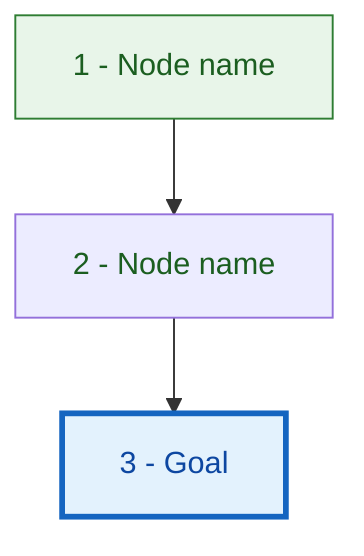
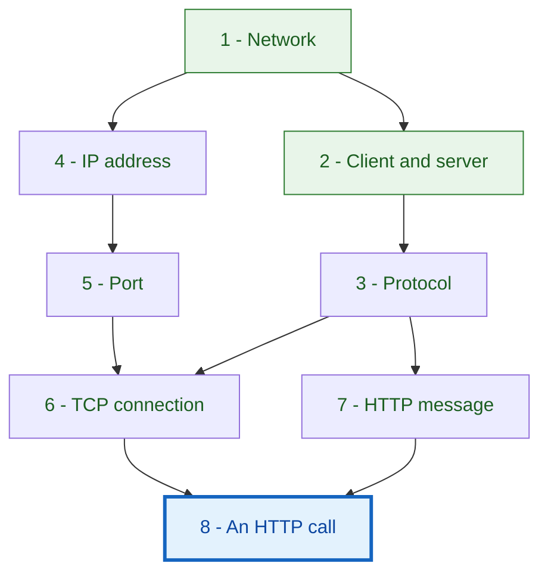
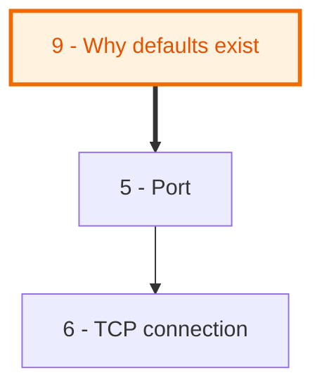

# Mermaid diagrams for the concept graph

The diagram is the first thing the learner sees in Phase 4 and in every Phase 6 repair. It must be understandable without a paragraph of explanation, so it is built for clarity first.

## Contents

- Core conventions
- Reference template
- Example (HTTP)
- Showing an updated graph after a gap
- Big graphs
- Syntax pitfalls
- Rendering

## Core conventions

- **Direction.** `flowchart TD` (top-down) by default; use `LR` if the graph is wide and shallow. Arrows go **from prerequisite to dependent**, so reading follows the learning path, from simple foundations to the goal.
- **Node ids and labels.** ids are `n1`, `n2`, ... matching the step numbering the learner will see. Labels are short (2-5 words), wrapped in double quotes, and begin with the number: `n4["4 - IP address"]`.
- **Status styling** via `classDef`:
  - `root` - no dependencies (layer 0). Green.
  - `known` - the user said they know it. Grey, muted.
  - `optional` - parked branch. Dashed border.
  - `goal` - the node(s) answering the original question. Thick blue border.
  - `gap` - added or changed in response to a side question. Orange, thick border.
  - `compact` - kept in brief form because something depends on it. Lighter fill.
- **Edges.** `-->` for ordinary dependencies. `==>` (thick) for edges newly added in a repair. `-.->` (dotted) for optional dependencies.
- **Layers.** Optionally group with `subgraph` blocks named by layer or theme ("Foundations", "Building blocks", "Putting it together"). Use them when they make the picture clearer, not by default; too many boxes-in-boxes hurt readability.
- **Legend.** Include a one-line legend only if more than three styles appear.
- **Text under the diagram.** Very little (see SKILL.md Phase 4). The diagram should speak for itself.

## Reference template



## Example (HTTP, simplified)

Question: "How does an HTTP call work?" This is illustrative; a real plan would be larger.



Followed by the path list:

1. Network, client and server - who talks to whom and why
2. Protocol - why agreed rules are needed
3. IP address and port - how to find the right program on the right machine
4. TCP connection - how a reliable channel is set up
5. HTTP message - what is actually sent
6. A full HTTP call - putting it all together

## Showing an updated graph after a gap

When a side question adds or changes nodes (Phase 6):

- Output the **whole** updated diagram, not a diff, so the learner sees the complete picture again.
- Give new nodes the `gap` class. Draw new edges with `==>`.
- If a node moved earlier or later in the order, mention it in the single line below the diagram, not in the diagram.
- Keep ids stable. New nodes get the next free number, even if they are taught earlier. If numbering would confuse (for example "Step 3" now precedes a node labeled 11), say: "Numbers are ids, not the order; the path below shows the order."
- After that step is taught, the node loses the `gap` highlight in later diagrams, but stays marked in the final summary's gap log.

Example repair marker:



## Big graphs

If the full graph exceeds about 30-40 nodes it stops being readable. Options, in order of preference:

1. **Overview + modules.** One overview diagram with each module as a single box (and arrows between modules), then a detailed diagram per module shown at the start of that module. Tell the learner how modules connect.
2. **Cluster subgraphs.** Group nodes in `subgraph` blocks by theme.
3. **Layer-by-layer reveal.** Show the full graph with later layers collapsed into a labeled "Part 2" box, and expand it when reached.

Whichever you choose, every node must still appear in exactly one diagram where its edges are visible, so no dependency is hidden.

## Syntax pitfalls

- Quote every label: `n3["3 - Protocol (rules)"]`. Unquoted parentheses, colons, and slashes break parsing.
- Avoid characters that Mermaid treats specially in labels (unquoted `{ } [ ] ( ) | < >`). Use plain words.
- Node ids must be alphanumeric with no spaces: `n12`, not `n 12` or `12`.
- Define `classDef` lines before they are used, and apply them with `:::name` after the node.
- Keep edges on their own lines.
- `==>` is the thick arrow, `-.->` is dotted.
- Do not put a blank line inside a node label. Use `<br/>` only if really needed (it needs quotes).
- If a `mermaid-diagrams` skill or a diagram-rendering tool is available in your environment, consult it for current syntax before drawing larger graphs.
- Re-read your diagram once for typos in ids; a single misspelled id silently creates a stray extra node.

## Rendering

- Present diagrams as a fenced ```` ```mermaid ```` code block. In environments that render Mermaid, this displays as a picture.
- If the environment offers a dedicated renderer (an artifact or visual tool that supports Mermaid), use it for the large overview diagrams. Still keep the diagram as the first thing in the message.
- If the learner says the diagram does not render, offer the same graph as an indented text outline (layer by layer, with "needs: ..." under each node), so the information is never lost.
