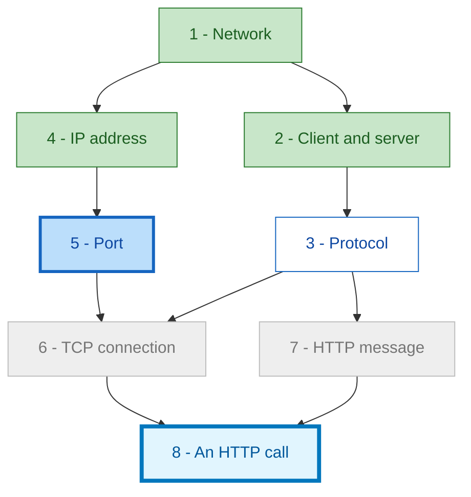
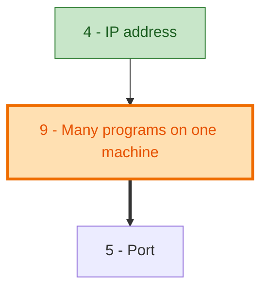

# Mermaid maps with progress colours

The map does two jobs here: it shows the whole territory at the start (Phase 4), and it is a **progress board** that is redrawn every time the learner completes a node, so they can see what is done and what is left.

## Contents

- Core conventions
- Status colours
- Reference template
- Progress update messages
- Showing a repair (gap)
- Big graphs
- Syntax pitfalls
- Rendering

## Core conventions

- **Direction.** `flowchart TD` by default (`LR` if wide and shallow). Arrows go **from prerequisite to dependent**, so the flow reads from simple foundations to the goal.
- **Ids and labels.** ids `n1`, `n2`, ... are stable for the whole session and match the numbers the learner sees. Labels are short (2-5 words), in double quotes, starting with the number: `n4["4 - IP address"]`.
- **One class per node.** Assign exactly one `:::class` to each node. If a combination is needed (for example a finished goal), define a dedicated class for it instead of stacking classes.
- **Whole map every time.** Always redraw the complete graph, never a diff, so the learner always sees the full picture.
- **Text under the map.** Minimal: a one-line status ("5 of 11 done, 1 shaky") and, if useful, the next node. The colours do the talking.

## Status colours

Define all of these in every diagram (unused ones can be omitted if the diagram is small):

| Class | Meaning | Look |
|---|---|---|
| `done` | Mastered | Green fill, solid |
| `shaky` | Passed with heavy help; a recall is scheduled | Yellow fill |
| `current` | The node being worked on right now | Blue fill, thick border |
| `ready` | All prerequisites done; could be next | White with a blue border |
| `todo` | Not yet reachable (some prerequisite is not done) | Light grey |
| `known` | The learner said they already know it | Muted blue-grey |
| `compact` | Kept in brief form because something depends on it | Pale lime |
| `optional` | Parked branch | Dashed border, white |
| `gap` | Added in response to a question (this repair) | Orange, thick border |
| `goal` | The node answering the original question (not yet done) | Light blue, very thick border |
| `goalDone` | The goal, completed | Green, very thick border |

A one-line legend is useful when more than four colours are visible. Example legend line: `green done · yellow shaky · blue now · white ready · grey locked · orange new`.

## Reference template



## Progress update messages

Redraw the map **every time a node is completed** (done or shaky). The shape of the message:

1. Brief confirmation and consolidation of the finished node (see `socratic-method.md`).
2. The full updated map.
3. One status line: `5 of 8 done · 1 shaky · next: Protocol`.
4. The opening scene and first question of the next node, in the same message, so the learner never has to say "continue".

Recolouring rules:

- The node just completed becomes `done` (or `shaky`).
- The next node becomes `current`.
- Any node whose prerequisites are now all done and that is not current becomes `ready`.
- Nodes still blocked stay `todo`.
- A shaky node upgraded after a recall becomes `done`.
- When the goal node is completed, use `goalDone`.

If the learner jumps to a different node (allowed when its prerequisites are done), mark that one `current` and keep the other as `ready`.

## Showing a repair (gap)

When a question reveals a hole in the plan (see `gap-repair.md`):

- The updated map is the **first thing** in the reply.
- New nodes use `gap`. Draw new edges with `==>` (thick). Keep all other nodes at their present status colours.
- One or two lines below name the gap and what changed.
- After the patch node is completed it becomes `done`/`shaky` like any other, and the `gap` colour disappears from later maps (the gap log keeps the history for the final summary).

Example fragment:



## Big graphs

Above roughly 30-40 nodes a single map is unreadable. Options:

1. **Overview of modules** (one box per module, coloured by progress: all done, partly done, not started), plus a detailed map of the **current module** only. Redraw the module map and the current detail map on node completion.
2. **Cluster subgraphs** coloured by their members.
3. **Collapse done regions** into one green box ("Foundations: 12 nodes done") and show the rest in detail.

Every non-done node must remain visible with its edges in some diagram.

## Syntax pitfalls

- Quote labels: `n3["3 - Protocol (rules)"]`. Unquoted parentheses, colons, and slashes break parsing.
- Avoid unquoted `{ } [ ] ( ) | < >` in labels.
- ids alphanumeric, no spaces.
- Define all `classDef` lines before they are used. Apply with `:::name` after the node.
- One class per node (define combined classes when needed).
- `==>` is thick, `-.->` is dotted.
- Re-read ids once; a misspelled id silently creates a stray node.
- If a `mermaid-diagrams` skill or a diagram tool is available, consult it before drawing large graphs.

## Rendering

- Use a fenced ```` ```mermaid ```` block. Environments that render Mermaid display it as a picture.
- If the environment offers a dedicated renderer (an artifact or visual tool that supports Mermaid), it can be used for large overview maps, but keep the map inside the message flow so the learner sees it in place.
- If the learner says it does not render, offer a plain text board instead, listing nodes with a status tag, for example `[DONE] 1 Network`, `[NOW] 5 Port`, `[LOCKED] 6 TCP connection`.
